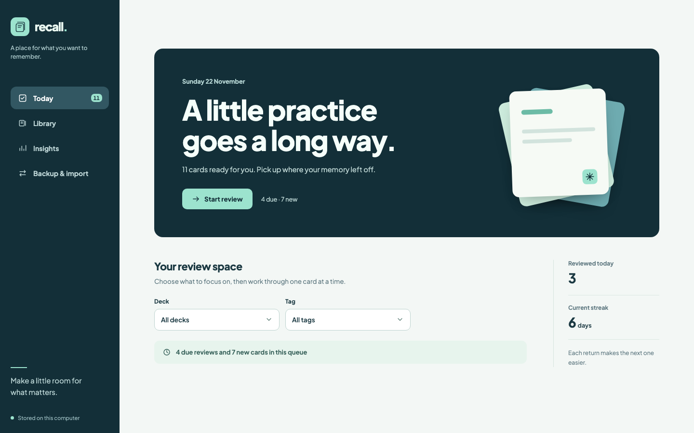

# Recall — Coding Challenge #147

A local spaced repetition trainer for one learner. Add decks and cards, practice a small daily queue, and keep a full backup of your learning history.



[Watch the 20-second walkthrough](demo/media/recall-demo-widescreen.mp4) · [View the square cut](demo/media/recall-demo-square.mp4)

## Run

Requires Python 3.10 or later. No package installation is needed.

```sh
python3 trainer.py
```

Open http://127.0.0.1:8000. The app creates `trainer.sqlite3` beside the source. It listens on loopback only.

For a different database, port, or simulated date:

```sh
python3 trainer.py --db /path/to/cards.sqlite3 --port 8001 --now 2026-11-22
python3 trainer.py --db /path/to/cards.sqlite3 --now 2026-11-23T12:00:00
```

Use a separate test database with `--now`; reviews made while time traveling are saved.

## Use

1. Open **Library**, create a deck, then add cards with a front and back. Add tags when useful.
2. Open **Today**. Choose a deck or tag to narrow the queue, then start.
3. Recall the answer before revealing it. Rate with **Again**, **Hard**, **Good**, or **Easy**. Space reveals; keys 1–4 rate in that order.
4. Open **Insights** for today's activity, the next seven days, streak, learned cards, and each deck's retention.
5. Open **Backup & import** to add CSV cards, share a CSV, or download/restore a full JSON backup.

Deck deletion asks for confirmation and states the number of cards and review histories removed. Tag deletion leaves cards intact. Search matches the front, back, and tag names. A daily queue introduces up to ten never reviewed cards across all sessions in one calendar day. Due reviews are shown alongside them.

## Scheduling

[Piotr Woźniak's SM-2 description](https://www-beta.supermemo.com/en/articles/history) is the baseline: ease starts at 2.5, the first two **Good** intervals are 1 and 6 days, later intervals multiply by ease and round up, and ease never falls below 1.3. The four labels map to response quality 1, 3, 4, and 5.

The challenge also calls for **Again** within minutes and a noticeably longer **Easy** interval. These are documented adaptations to classic SM-2:

| Rating | Effect |
| --- | --- |
| Again | Resets successful repetitions, keeps ease, and returns in 10 minutes. |
| Hard | Lowers ease; uses 1, then 3 days, then a reduced multiplier. |
| Good | Uses the original 1, then 6 days, then ease multiplier. |
| Easy | Raises ease; uses 4, then 10 days, then a larger multiplier. |

Only cards due at or before the current local time enter the queue. A card rated Again will return when its 10-minute due time arrives, typically in a later session. A card counts as **learned** once its current interval reaches 21 days. Retention is successful reviews (Hard, Good, Easy) divided by all reviews in that deck.

## Import and export

CSV needs `front` and `back` headers. Optional `deck` (or `deck name`) and `tags` columns are accepted. Multiple tags go in one quoted, comma-separated cell. Missing decks and tags are created automatically. See [sample.csv](sample.csv).

CSV export contains card text, deck name, and tags. **JSON is the complete backup**: it includes decks, cards, tags, schedules, and review history. Export all data or one deck. Restoring JSON replaces the entire current collection in one database transaction; download a full backup first if needed.

## Check

```sh
python3 -m unittest discover -s tests -v
node --check app.js
```

On macOS with Google Chrome installed, the dependency-free browser smoke test checks a mobile viewport, tag rename/search, filtered review, and the create → reveal → review flow:

```sh
node tests/browser_smoke.mjs
```

The browser test uses a disposable SQLite database and cleans up its temporary files. The Python tests cover scheduling, daily new-card limits, persistence, filters, cascade deletion, streaks, retention, CSV import, JSON round-trip, and HTTP endpoints.

## Demo collection

The [demo guide](demo/README.md) explains how to run a separate sample database with 18 cards, tags, review history, and progress stats. The [complete JSON backup](demo/recall-demo.json) can be restored into a separate database. The demo media lives in [demo/media](demo/media). Your default local `trainer.sqlite3` is not included in this repository.

## Scope

This is a single-user local app. It has no account system or cloud sync. Rich media, Markdown, reverse cards, and alternative schedulers are optional extensions outside the six required steps.
